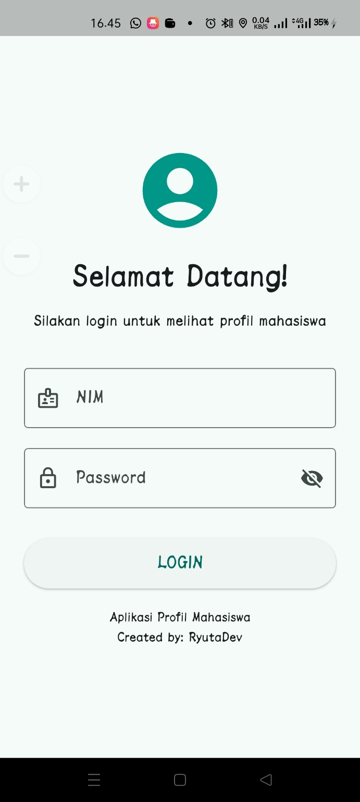
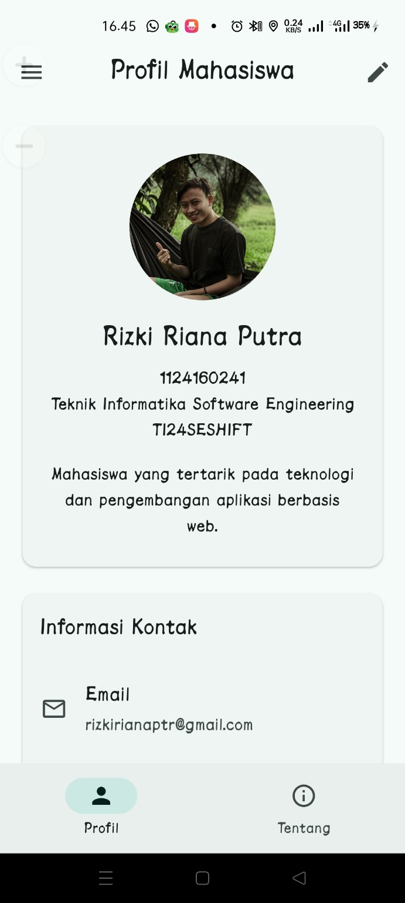
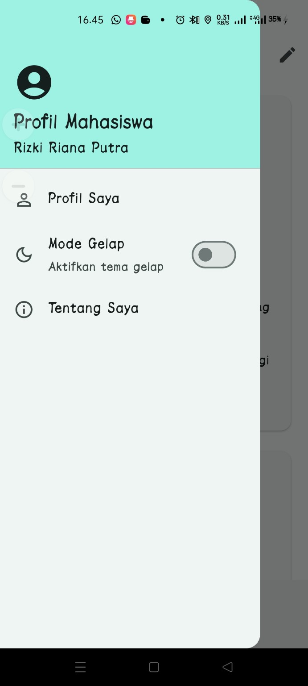
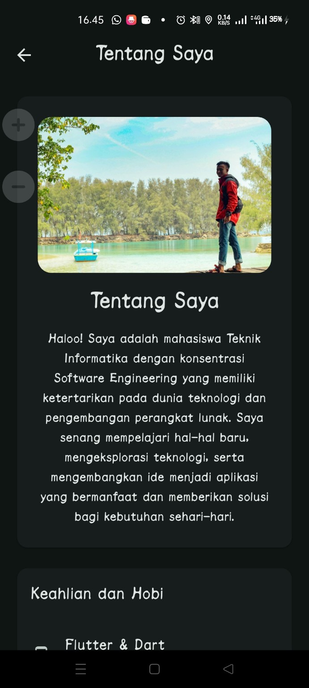

# UTS Pemrograman Mobile — Aplikasi Profil Mahasiswa

Aplikasi profil mahasiswa berbasis Flutter untuk memenuhi tugas Ujian Tengah Semester (UTS) Mata Kuliah Pemrograman Mobile.

## Identitas Mahasiswa

| Keterangan | Data |
|---|---|
| Nama | Rizki Riana Putra |
| NIM | 1124160241 |
| Kelas | TI24SESHIFT |
| Program Studi | Teknik Informatika — Software Engineering |
| Institusi | Institut Teknologi & Bisnis Bina Sarana Global |

## Struktur Repository

- `soal1-live-coding/` — proyek Flutter Soal 1 (Live Coding).
- `soal2-profil-app/` — proyek Flutter Soal 2 (Aplikasi Profil Mahasiswa).
- `README.md` — dokumentasi utama repository.

## Fitur Aplikasi (Soal 2)

- Login dengan validasi form dan indikator loading.
- Halaman profil mahasiswa beserta foto dan informasi kontak.
- Edit profil dengan validasi nama, email, dan nomor HP.
- Pengiriman data hasil edit kembali ke halaman profil menggunakan navigasi.
- Halaman Tentang Saya berisi deskripsi, keahlian, hobi, dan riwayat pendidikan.
- Navigasi menggunakan Drawer dan Bottom Navigation Bar.
- Light Mode dan Dark Mode.
- Nama aplikasi Android: Profil Rizki Riana Putra.

## Screenshot Aplikasi

### Login


### Profil Mahasiswa


### Drawer


### Edit Profil


### Tentang Saya


## Cara Menjalankan

Pastikan Flutter SDK sudah terpasang. Jalankan perintah berikut dari folder proyek Soal 2:

```bash
cd soal2-profil-app
flutter pub get
flutter run
```

Untuk membuat APK release:

```bash
flutter build apk --release
```

File APK hasil build berada di:

`build/app/outputs/flutter-apk/app-release.apk`

## Video Presentasi YouTube

**Link video:** (https://youtu.be/9bZBJ_aKzaI)

## GitHub

Repository: https://github.com/RiyutaDev/uts_pml_1124160241

## Download APK

Versi: v1.0.0

[Download Aplikasi Profil Mahasiswa](https://github.com/RiyutaDev/uts_pml_1124160241/releases/tag/v1.0.0)